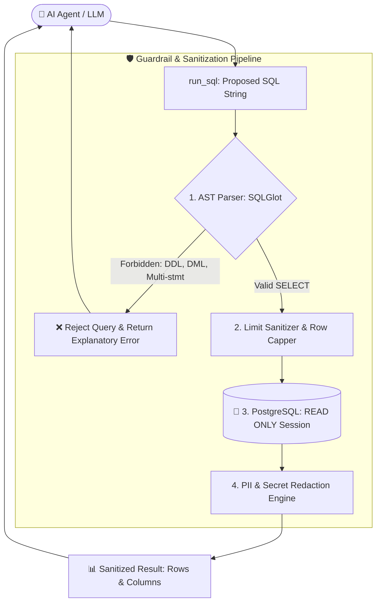

# 🚀 Production-Ready Secure SQL MCP Server with FastMCP, PostgreSQL & SQLGlot

[](https://www.python.org/)
[](https://modelcontextprotocol.io/)
[](https://www.postgresql.org/)
[](https://github.com/tobymao/sqlglot)
[](https://www.sqlalchemy.org/)
[](https://astral.sh/uv)

A production-grade, educational implementation of a **Secure SQL Model Context Protocol (MCP)** server.

This project demonstrates how to connect autonomous AI agents (such as **Google Antigravity**, **Claude Desktop**, **Cursor**, and **Zed**) to an operational SQL database using a **defense-in-depth security model** that prevents prompt-injected SQL mutations, enforces read-only transactions, and automatically redacts PII data.

---

## 📌 Architecture & Security Pipeline

Connecting an LLM directly to a database without guardrails invites severe vulnerabilities: SQL injection via prompt injection, destructive DDL/DML execution, or context window exhaustion.

This project solves these challenges through a **4-stage security pipeline**:



---

## 🛡️ Defense-in-Depth Mechanisms

| Stage | Technology | Security Function |
| :--- | :--- | :--- |
| **1. AST Parsing** | `sqlglot` | Parses queries into an Abstract Syntax Tree. Whitelists `SELECT`/`UNION` and strictly rejects `DROP`, `DELETE`, `UPDATE`, `INSERT`, `ALTER`, `TRUNCATE`, and multi-statement execution. |
| **2. Query Sanitizing** | AST manipulation | Automatically injects a `LIMIT` clause if omitted, and caps user-specified limits to prevent buffer overruns and context overflow. |
| **3. Session Enforcing** | `asyncpg` + `SQLAlchemy` | Executes `SET SESSION CHARACTERISTICS AS TRANSACTION READ ONLY` on each pool connection, providing a database-level kernel lock against modifications. |
| **4. PII Redaction** | `Pydantic` + regex rules | Dynamically masks confidential columns (`password`, `token`, `secret`, `api_key`, `credit_card`) with `[REDACTED]`. |
| **5. Protocol Hygiene** | `sys.stderr` routing | Routes all application logs strictly to `stderr`, preserving `stdout` for unbroken MCP JSON-RPC frame serialization. |

---

## 🏗️ Clean Modular Structure

```text
mcp-sql-service/
├── .env.example              # Typed configuration template
├── pyproject.toml            # Modern UV project & dependencies
├── README.md                 # Educational documentation
│
├── tests/
│   └── test_security.py      # Automated SQL injection & sanitization test suite
│
└── src/
    └── mcp_sql/
        ├── main.py           # FastMCP server registration & entrypoint
        ├── config.py         # Pydantic Settings with env parsing & validation
        │
        ├── core/
        │   ├── database.py   # Async connection pool & read-only session manager
        │   ├── exceptions.py # Domain-specific custom exception hierarchy
        │   └── logger.py     # Stderr-only structured logging setup
        │
        ├── security/
        │   ├── validator.py  # SQLGlot AST validation engine
        │   └── sanitizer.py  # Automatic LIMIT injection and PII redaction
        │
        └── tools/
            ├── schema.py     # Schema introspection tools (get_tables, inspect_table)
            └── query.py      # Sandboxed query runner with execution timeouts
```

---

## 🛠️ MCP Tools Specification

| Tool | Parameters | Return Type | Purpose |
| :--- | :--- | :--- | :--- |
| `get_tables` | *None* | `list[str]` | Lists all accessible tables in the schema so the model can ground its knowledge. |
| `inspect_table` | `table_name: str` | `list[dict]` | Returns column names, data types, and nullability to prevent column hallucinations. |
| `run_sql` | `query: str` | `dict` | Validates, sanitizes, and executes safe read-only queries with structured error reporting. |

---

## ⚡ Quickstart

### 1. Requirements
- Python 3.11+
- [uv](https://astral.sh/uv) (fast Python package manager)
- PostgreSQL database instance

### 2. Setup & Installation

```bash
# Clone the repository
git clone https://github.com/RavshanjonA/fastmcp-postgres.git
cd fastmcp-postgres

# Install dependencies in an isolated virtual environment
uv sync

# Configure environment variables
cp .env.example .env
```

### 3. Verify Database Connectivity

```bash
uv run python -c "
import asyncio
from mcp_sql.core.database import check_database_connection

async def main():
    ok = await check_database_connection()
    print('DB Connection:', '✅ SUCCESS' if ok else '❌ FAILED')

asyncio.run(main())
"
```

---

## 🧪 Testing

### Run Security & Parser Unit Tests
```bash
uv run pytest tests/test_security.py -v
```

### Inspect Endpoints via MCP Inspector
Test tool schemas and execute queries interactively in a web browser:
```bash
npx @modelcontextprotocol/inspector uv run python src/mcp_sql/main.py
```

---

## 🔌 Agent Configurations

To connect this server to your preferred AI agent, add the following configuration:

### Google Antigravity (`~/.gemini/config/mcp_config.json`)
```json
{
  "mcpServers": {
    "secure-sql": {
      "command": "uv",
      "args": [
        "--directory",
        "/absolute/path/to/mcp-sql-service",
        "run",
        "python",
        "src/mcp_sql/main.py"
      ]
    }
  }
}
```

### Claude Desktop (`claude_desktop_config.json`)
```json
{
  "mcpServers": {
    "secure-sql": {
      "command": "uv",
      "args": [
        "--directory",
        "/absolute/path/to/mcp-sql-service",
        "run",
        "python",
        "src/mcp_sql/main.py"
      ]
    }
  }
}
```

### Zed Editor (`.zed/settings.json`)
```json
{
  "context_servers": {
    "secure-sql": {
      "command": "uv",
      "args": [
        "run",
        "python",
        "src/mcp_sql/main.py"
      ]
    }
  }
}
```

---

## 📜 Educational Purpose & License

This project is licensed under the **MIT License**. It serves as a reference architecture for building production-grade, secure tool integrations under the Model Context Protocol specification.
